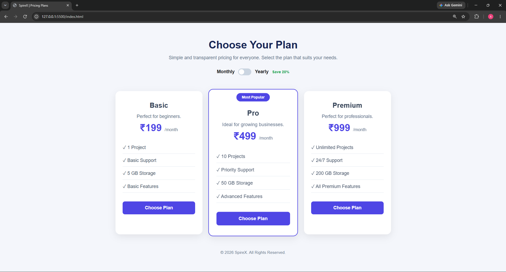
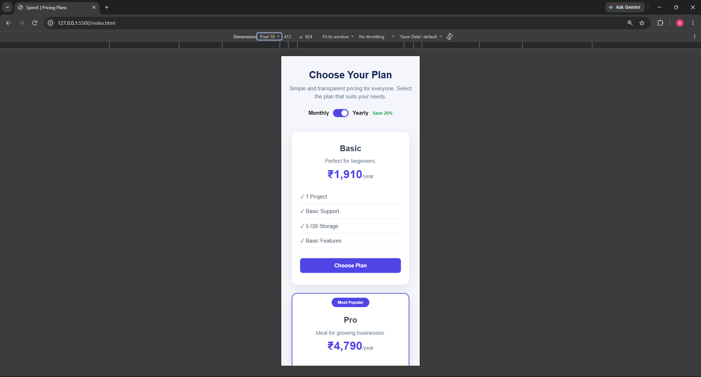

# SpireX Task 4 – Responsive Pricing Cards

A responsive pricing cards section built using **HTML, CSS, and JavaScript**. It displays three subscription plans with pricing details, features, and interactive monthly/yearly billing options.

## Features

- Three pricing plans: Basic, Pro, and Premium
- Monthly and yearly billing toggle
- Dynamic price updates using JavaScript
- Highlighted Most Popular plan
- Interactive Choose Plan buttons
- Responsive layout for desktop and mobile
- Hover effects and modern UI design

## Technologies Used

- HTML5
- CSS3
- JavaScript

## Screenshots

### Desktop View


### Mobile View


## Project Structure

```text
SpireX-Task4/
│
├── index.html
├── style.css
├── script.js
├── screenshots/
│   ├── desktop.png
│   └── mobile.png
└── README.md
```

## How to Run

1. Clone this repository.
2. Open the project folder in VS Code.
3. Open `index.html` using Live Server.
4. Switch between Monthly and Yearly billing.
5. Click Choose Plan to test the buttons.

## Pricing Plans

| Plan | Monthly | Yearly |
|---|---:|---:|
| Basic | ₹199 | ₹1,910 |
| Pro | ₹499 | ₹4,790 |
| Premium | ₹999 | ₹9,590 |

## Author

**Aashlesha Vijay Sawane**

GitHub: [@aashleshagit](https://github.com/aashleshagit)

---

© 2026 SpireX – Task 4
